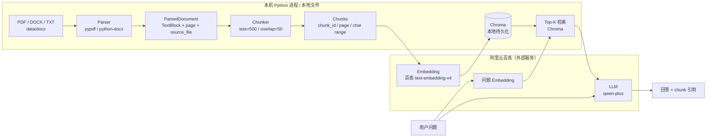

# 系统架构与数据流向（M1）

> 版本：M1（2026-10-19）
> 当前实现：解析（parser）与切分（chunker）；Embedding、Chroma、检索、LLM 为后续里程碑。

## 1. 目标架构

**M1 已实现**：`D → P → PD → C → CH`。  
**未实现**：`CH → E → V → R → L → A`。

## 2. 外部服务边界（后续步骤必须遵守）

> **文档 chunk 文本与用户问题会发送至阿里云百炼外部服务。**

- Embedding：chunk 文本发送到 `text-embedding-v4`；
- LLM：问题与检索到的 chunk 发送到 `qwen-plus`；
- 原始文件保存在本机；文本内容离开本机；
- 只允许使用 `data/docs/` 下的虚构资料；禁止真实企业数据；
- M1 阶段不调用外部服务，不产生费用。

## 3. M1 数据模型

### ParsedDocument

| 字段 | 说明 |
| --- | --- |
| `source_file` | 相对项目根目录的源文件路径 |
| `file_type` | `pdf` / `docx` / `txt` |
| `blocks` | `TextBlock` 列表 |
| `metadata` | 页数、编码、解析器等 |

### TextBlock

| 字段 | 说明 |
| --- | --- |
| `text` | 解析文本 |
| `source_file` | 源文件 |
| `block_index` | 文档内 block 序号 |
| `page` | PDF 页码（1-based）；DOCX/TXT 为 `None` |
| `kind` | `page` / `paragraph` / `table` / `text` |

### Chunk

| 字段 | 说明 |
| --- | --- |
| `text` | chunk 文本 |
| `source_file` | 源文件 |
| `chunk_id` | 文档内 1-based 序号 |
| `page` | chunk 起始位置所在页码（如可得） |
| `char_start` / `char_end` | 相对整篇文档全文的字符区间 |

## 4. 错误模型

`DocumentParseError` 始终包含：

- `type`：`unsupported_format` / `empty_document` / `corrupted_file` / `file_not_found` / `parse_failure`；
- `file`：文件名；
- `reason`：可读原因；
- `source_file`：路径。

解析报告不会静默跳过失败文档；错误会进入 `parse-report.json` 并以非零退出码提示。

## 5. 后续里程碑

1. M2：百炼 Embedding + Chroma 持久化；
2. M3：Top-K 检索与评分；
3. M4：`qwen-plus` 回答与 chunk 引用；
4. M5：复用项目一 30 题测试集做对照评测。
